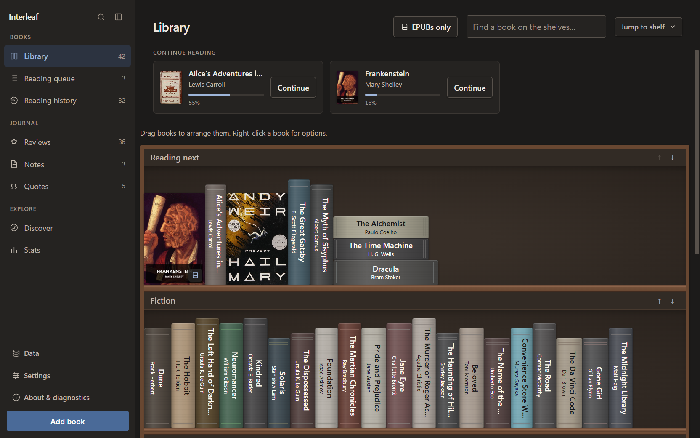
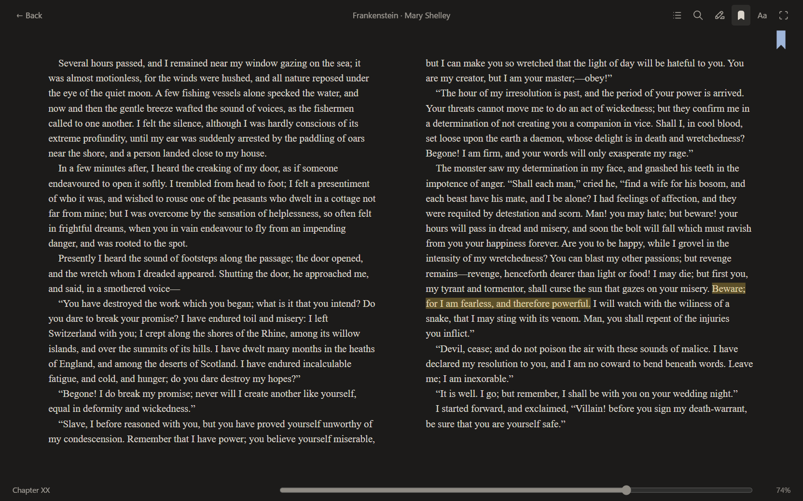
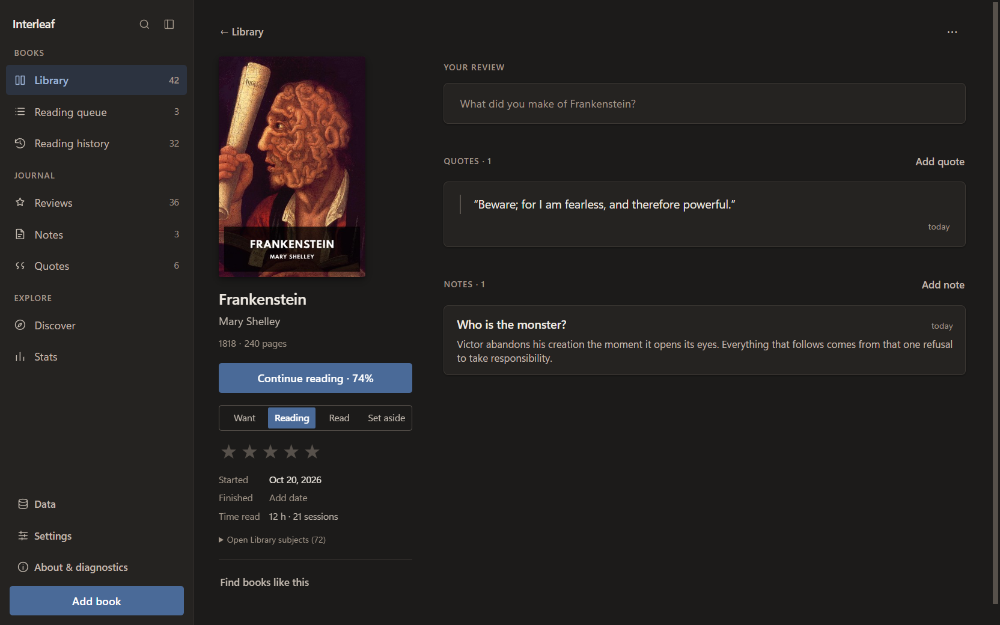
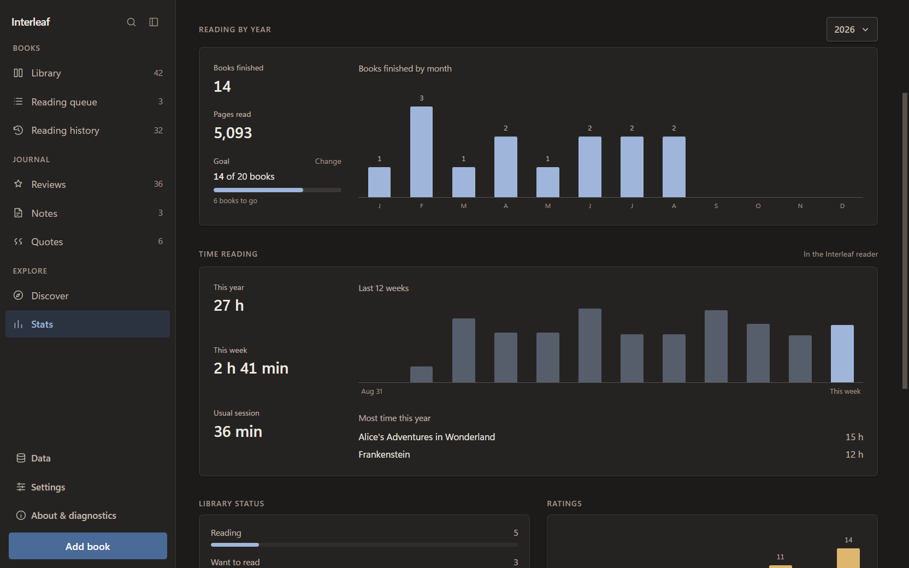

# Interleaf

[](https://github.com/sometabs/interleaf/actions/workflows/ci.yml)

An offline-first desktop reading companion for Windows and Linux. Organize your library, read your
EPUBs, capture notes and quotes, plan your reading queue, and discover what to read next based on
your own books.

## Interleaf in use

**Library.** Pick up where you left off, then browse named shelves of upright spines, horizontal
stacks and covers turned face out. Books you can read in Interleaf carry a small mark.



**Reader.** Read EPUBs in one or two pages or scrolling, in light, sepia, dark, or a theme that
follows the app. Select a passage to keep it as a quote or a note, and bookmark pages as you go.



**Reading journal.** A book's page gathers its status, rating, reading dates, time read, review,
quotes and notes.



**Stats.** Follow your yearly goal, the books you finished each month, and how much time you spend
reading.



## What you can do

- Add books from Open Library or enter them manually. Choose Grid or Shelf in Settings.
- Attach an EPUB to a book, or drop one on the window, then read it in Interleaf. Footnotes open in
  a popup, and quotes you save reopen at their place in the book.
- Order your reading queue, revisit finished books in reading history, and set a yearly reading goal.
- Discover what to read next from the books you rated highly, as cards or a similarity tree, or
  find books like a specific title in your library.
- Import Calibre or Kindle highlights with duplicate detection. Kindle clippings need English headers.
- Press `Ctrl + K` to search your books, reviews, notes and quotes or run a command.

## Install

Download the Windows installer, AppImage or `.deb` from
[Releases](https://github.com/sometabs/interleaf/releases). From 1.20.0 on, Interleaf checks for a
new version when it starts and offers to restart into it. The Windows installer isn't signed, so
Windows may warn the first time: click **More info**, then **Run anyway**.

To build from source, install [Node.js 22.12 or newer](https://nodejs.org) and Git.

```bash
git clone https://github.com/sometabs/interleaf.git
cd interleaf
npm ci
```

Run `npm run build:win` for a Windows installer or `npm run build:linux` for a Linux AppImage and
`.deb`. Build on the target operating system and find the result in `dist/`. Run `npm run dev`
to try the app from source with a separate `Interleaf Dev` library.

## Your data and offline use

Your library, the reader, writing, search, and statistics work offline. Book lookup, metadata
refresh, and fetching new Discover candidates use Open Library. Interleaf ranks cached candidates
locally. Optional **Advanced recommendations** adds meaning-based matching and may download a
model on first use. At startup Interleaf asks GitHub whether a newer version exists; it sends
nothing about your library.

EPUBs stay on your computer: Interleaf keeps its own copy and never changes the original. Books
protected with DRM aren't supported and are refused when you attach them.

**Data → Back up** saves your whole library, EPUBs included, to a folder you choose, and
**Restore** brings it back on this computer or a new one. Interleaf also keeps automatic backups,
in a folder you can change. **Export as Markdown** writes readable files for your notes app; it is
not a backup.

See [Library data and recommendations](docs/library-details.md) for data locations, backup
timing, and how recommendations work.

## License

[MIT](LICENSE).
