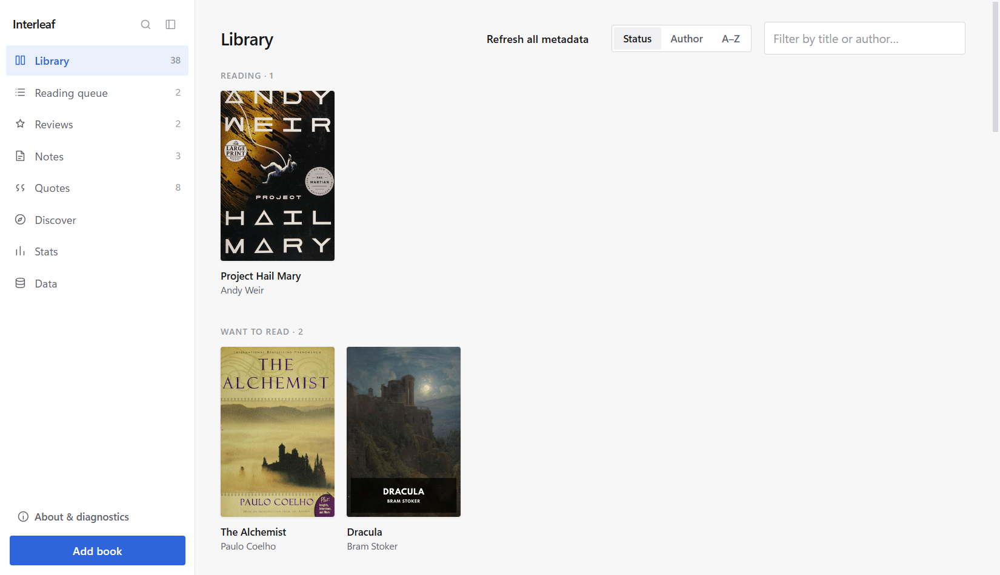
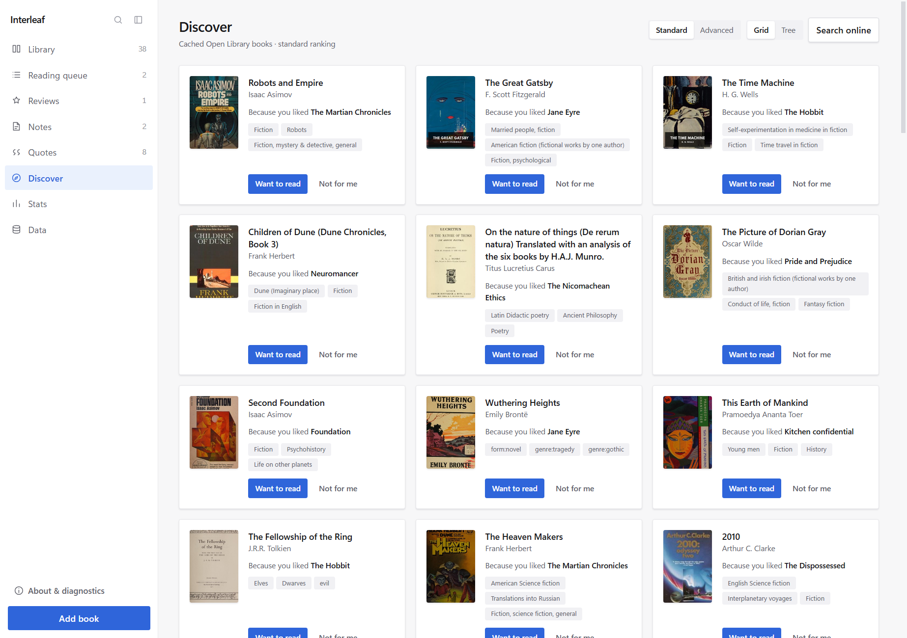
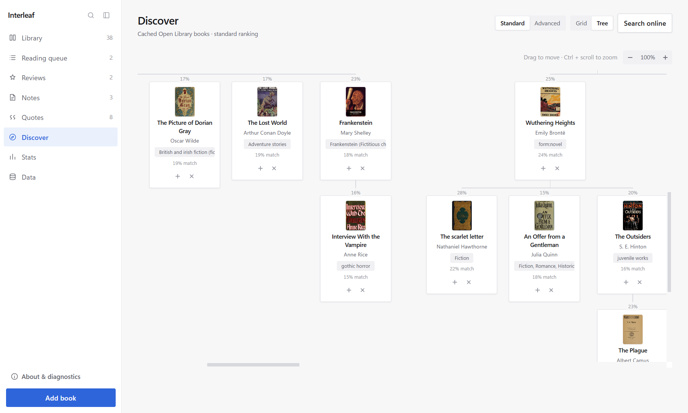
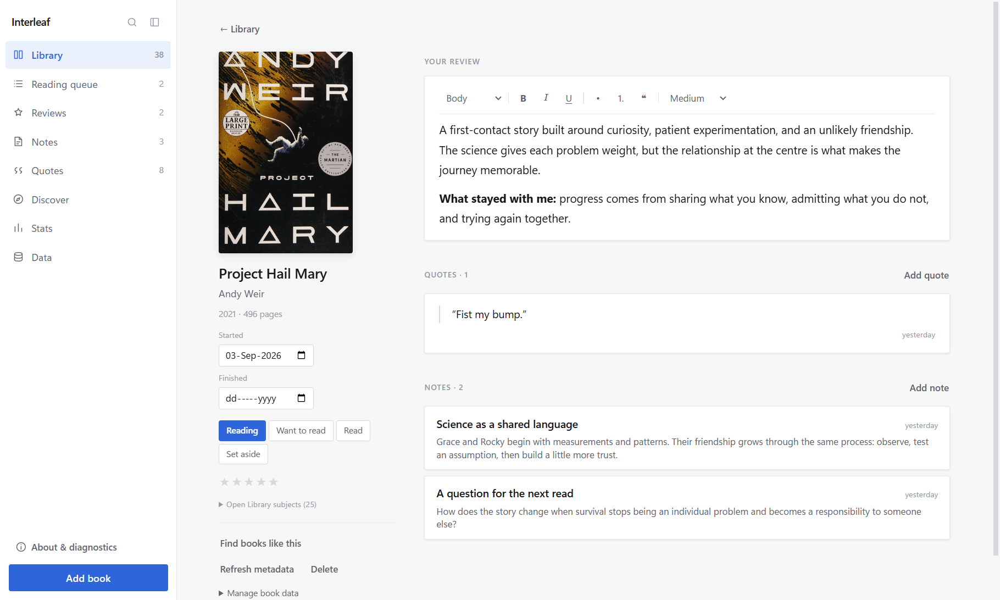
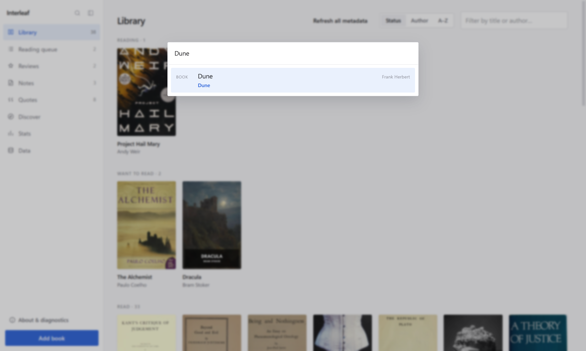
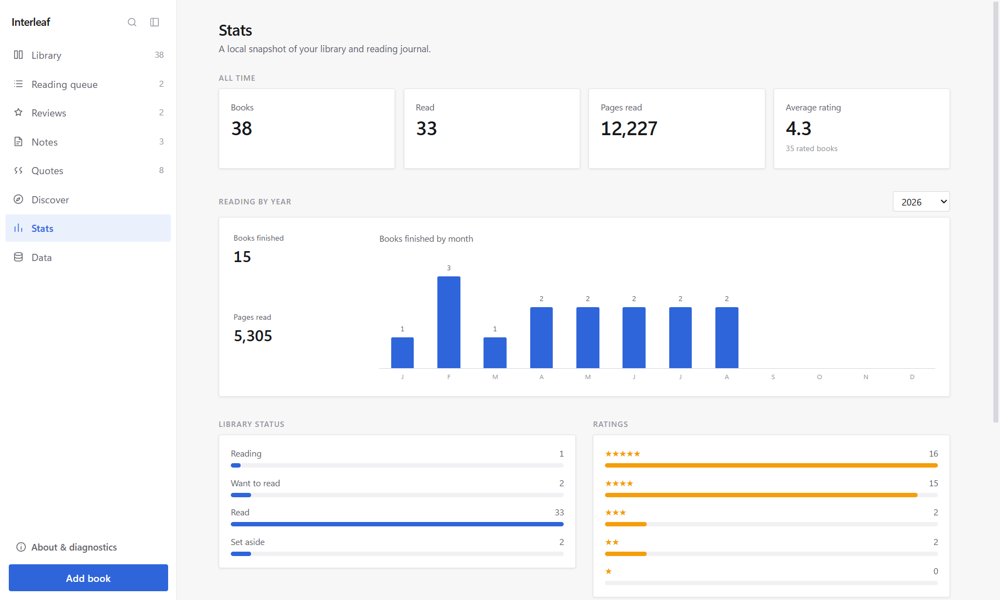

# Interleaf

[](https://github.com/sometabs/interleaf/actions/workflows/ci.yml)

A local-first desktop reading journal. Keep a shelf, arrange what to read next, write reviews and
notes, collect the passages worth keeping, and get recommendations ranked against your own library.

Your library and writing are stored on your machine. Internet access is needed for Open Library
searches, metadata refreshes, availability checks and the optional Advanced model download. Covers
are downloaded and cached as needed when books are added or displayed. Recommendation ranking
itself runs locally.



**Discover** ranks cached Open Library books against your shelf and says which of your books each
one resembles. Standard ranking uses local keyword similarity; Advanced uses a local embedding
model for meaning-based matching.



Explore recommendations as a tree. Zoom and pan to see how suggestions relate to one another;
this close-up shows a single branch.



A book page: reading details on the left, with the review, quotes and notes edited in place. The
sample entries below show a reading journal for _Project Hail Mary_.



`Ctrl + K` searches every book, review, note and quote at once.



Stats bring your reading progress, ratings and journal activity together in one local overview.



## Install

To build your own installer, you'll need
[Node 22.12 or newer](https://nodejs.org) and Git.

```bash
git clone https://github.com/sometabs/interleaf.git
cd interleaf
npm install
```

Then build the installer:

```bash
npm run build:win
```

It lands in `dist/`; run it to install the app normally.

**Platforms.** Packaging is configured for x64 Windows and Linux. On Linux, `npm run build:linux`
produces an AppImage and a `.deb`. Build on the target operating system; macOS packaging is not
configured.

To skip the installer and just run the app from source:

```bash
npm run dev
```

## What it does

**Your shelf.** Search Open Library by title, author or ISBN, choose the result you want, and keep its
available cover, edition identity and subjects. Page counts use Open Library's work-level median,
falling back to the selected edition's count when available. Nothing found, or offline? Add the book
manually. Each book is marked _want to read_, _reading_, _read_ or _set aside_, and can be rated out
of five. Books without usable cover art receive a generated clothbound cover instead of a blank box.

**Reading queue.** Every _want to read_ book appears in one ordered list. Drag books or use the
arrow controls to put them in the order you intend to read them.

**Reviews.** One per book, at the top of its page. Start typing; it saves itself.

**Notes.** What you thought. Attach them to a book, or write one that belongs to nowhere in
particular. Each can carry a label, and long ones open as a full page. The Notes screen can search
and filter by book or label.

**Quotes.** What the book said. They get their own section on each book and their own searchable
screen, filterable by book or author. Every quote belongs to a book; a thought that belongs to no
single book is a note.

**Search.** One box searches book titles and authors, plus the titles and text of reviews, notes and
quotes. It does not search the contents of the books themselves.

**Discover.** Recommendations built from your own shelf: Interleaf uses books you finished and rated
4 or 5 stars to search Open Library using their subjects and author names, then ranks the cached
pool locally using subjects and descriptions. Finished 3-star books provide a weaker positive
signal; 1–2-star ratings count against similar candidates. Standard mode uses TF-IDF keyword
similarity. Advanced mode asks for confirmation before a roughly 35 MB BGE Small model download
from Hugging Face, then uses local semantic embeddings. Suggestions identify a library book behind
the match. Your reviews, notes and quotes are not sent to either service.

**Grid or tree.** Browse the ranked list as cards, or explore the same pool as a similarity tree.
Candidates remain cached for offline ranking, and can be dismissed or added to your shelf.

**Books like this one.** Any book on your shelf has a **Find books like this** button, which ranks the
cached pool against that book alone. You can use those results immediately or run a targeted online
search for more candidates.

**Stats.** See all-time books and pages read, completed books by month for a selected year, library status,
ratings, top authors, and review, note and quote totals. Statistics are calculated locally from the
library you already maintain, including manually added books. Page totals count only read books
with a known page count. The year selector defaults to the current year and includes earlier years
with completed books. Choose All time for totals across all read books and completions by year.
Charts require a finished date; undated read books still count in all-time totals.

**Highlights from Calibre or Kindle.** Read a Calibre annotations export or Kindle My Clippings file
straight into Interleaf, preserving dates when they can be parsed. Match each source book to your
library once and Interleaf remembers it; re-importing the same highlights skips duplicates.
Kindle import currently recognises English clippings headers and skips bookmarks and standalone
notes. Nothing touches the source library or device.

**Backups.** One button writes the database, referenced covers and a readable Markdown copy to a
folder you choose. Reusing that destination replaces its previous database backup. Restore validates
a compatible backup, keeps one previous database copy, and restarts Interleaf on the restored
database. UI preferences and the downloaded model and embedding cache are not included.

**Your data, in plain text.** The Markdown in that folder is yours to read in any editor or keep in
Git: each book with its status and rating, its review, its notes and its quotes, each dated. It is
written for reading rather than for restoring, which the database beside it does.

**Data controls.** Delete individual entries from their own screens, remove one book's notes or
quotes, clear whole categories, reset the recommendation cache, remove the downloaded Advanced
model, and undo **Not for me** dismissals.

## Getting around

| key        | action                                     |
| ---------- | ------------------------------------------ |
| `Ctrl + K` | Search your library or run common commands |
| `Ctrl + N` | Add a book                                 |
| `Esc`      | Back one step                              |

The command palette also offers shortcuts to the main screens, adding a book or note, and backing
up your library.

Reviews and edits to existing notes and quotes save shortly after you stop typing. A new note or
quote remains a draft until you press **Done**; an empty draft is discarded.

## Where your data lives

- **Windows**: `%APPDATA%\Interleaf\`
- **Linux**: `$XDG_CONFIG_HOME/Interleaf/`, or `~/.config/Interleaf/` by default

Runs from source and preview builds use a separate `Interleaf Dev` directory under the same
platform-specific application-data folder, so development cannot modify the installed library.

That folder holds `interleaf.db` and the `covers/` directory, plus the local model and embedding cache
after Advanced is enabled. Use **Data → Back up** for a portable library backup. Do not treat
`covers/` as disposable: manually chosen covers may not be recoverable from Open Library.

## Notes and limits

Book data comes from [Open Library](https://openlibrary.org). When it is slow or unavailable,
Interleaf distinguishes that from an empty search, allows manual book entry, and keeps cached
recommendations available. Metadata refresh works only for books that already have an Open Library
Work ID. It updates subjects and descriptions and fills missing page counts and publication years,
without changing saved titles, authors, edition IDs, ISBNs or covers.

An online Discover search makes up to eight catalogue queries, spaced to respect Open Library's
request rate. It can take a minute or longer depending on response times and retries. Both ranking
modes work against the same cached candidate pool. Advanced matching uses an English-focused
embedding model, so non-English metadata may rank less reliably.

## Development

The test suite runs in two environments. The database, Open Library client, importers and
recommenders are tested in Node. React components are mounted in jsdom, a simulated browser, so UI
tests click real controls and type into real editors.

| command             | what it checks                     |
| ------------------- | ---------------------------------- |
| `npm test`          | the suite above                    |
| `npm run lint`      | ESLint, including formatting rules |
| `npm run typecheck` | `tsc` over main, preload and web   |

## License

[MIT](LICENSE).
