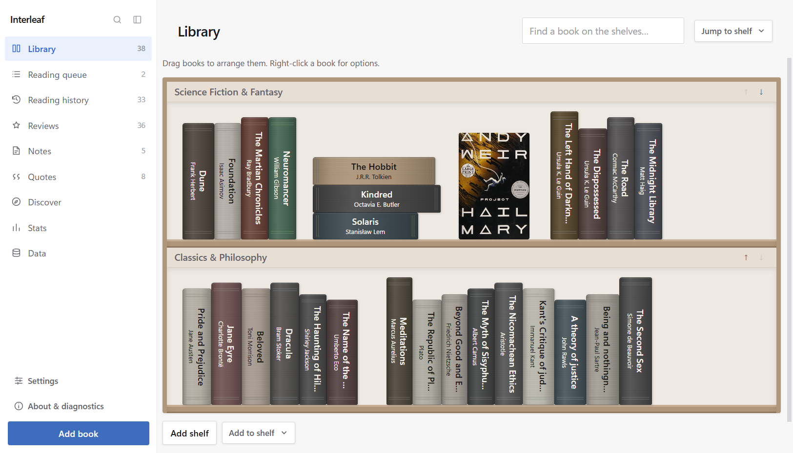
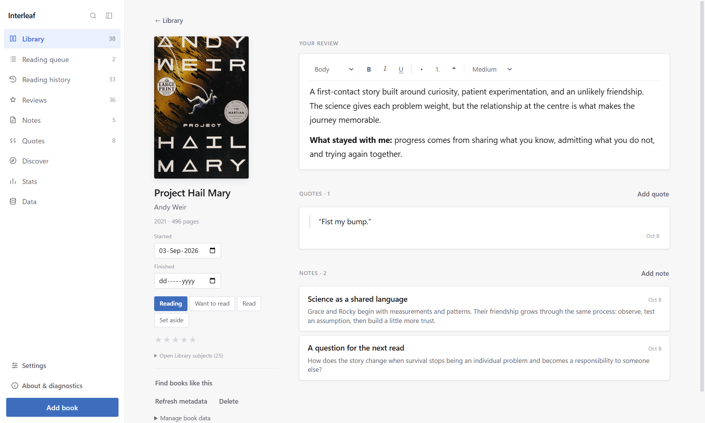
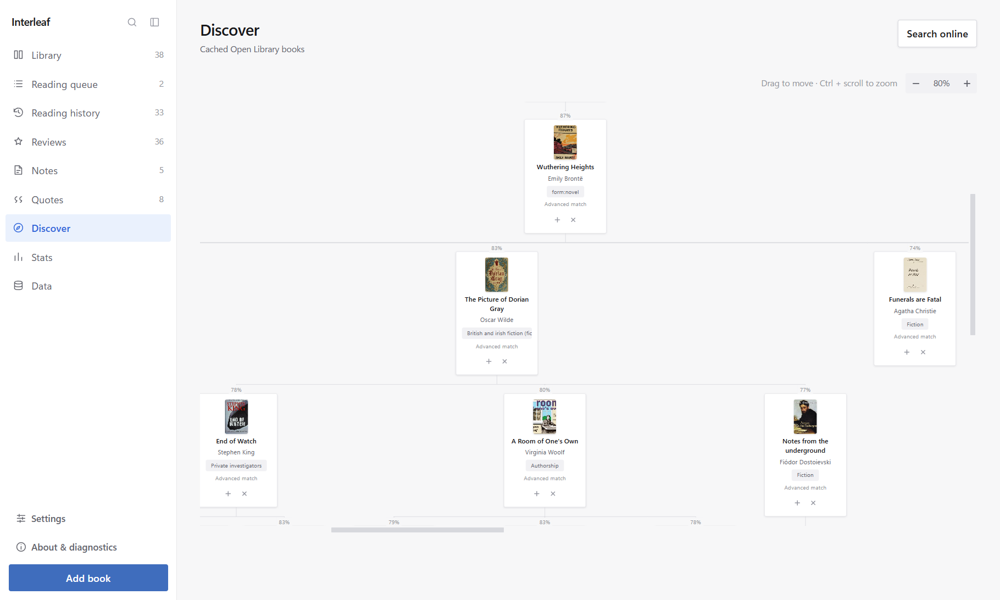

# Interleaf

[](https://github.com/sometabs/interleaf/actions/workflows/ci.yml)

A local-first desktop reading journal for Windows and Linux. Arrange your books, keep reviews,
notes and quotes, and discover what to read next based on your own library.

## Interleaf in use

**Bookshelf.** Name your shelves, arrange spines and horizontal stacks, and turn a book to show
its cover. Jump to a shelf by name or highlight a book where it sits.



**Reading journal.** See a book's rating, reading dates, review, quotes and notes on one page.



**Discover.** Browse recommendations as cards or a similarity tree, or find books like a specific
title in your library.



## What you can do

- Add books from Open Library or enter them manually. Choose Grid or Shelf in Settings.
- Order your reading queue, revisit finished books in reading history, and track your progress in Stats.
- Import Calibre or Kindle highlights with duplicate detection. Kindle clippings need English headers.
- Press `Ctrl + K` to search your books, reviews, notes and quotes or run a command.

## Install

To build from source, install [Node.js 22.12 or newer](https://nodejs.org) and Git.

```bash
git clone https://github.com/sometabs/interleaf.git
cd interleaf
npm install
```

Run `npm run build:win` for a Windows installer or `npm run build:linux` for a Linux AppImage and
`.deb`. Build on the target operating system and find the result in `dist/`. Run `npm run dev`
to try the app from source with a separate `Interleaf Dev` library.

## Your data and offline use

Your library, writing, search, and statistics work offline. Book lookup, metadata refresh, and
fetching new Discover candidates use Open Library. Interleaf ranks cached candidates locally.
Optional **Advanced recommendations** adds meaning-based matching and may download a model on
first use.

**Data → Export library** saves the database, including your shelf layout, along with book covers
and a readable Markdown copy. **Import** restores the library from the exported database.
Interleaf also keeps an automatic recovery copy for startup recovery.

See [Library data and recommendations](docs/library-details.md) for data locations, backup
timing, and how recommendations work.

## License

[MIT](LICENSE).
